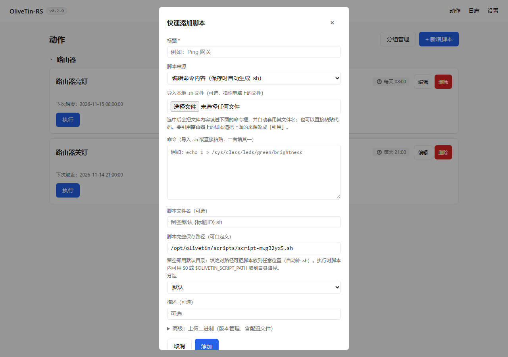
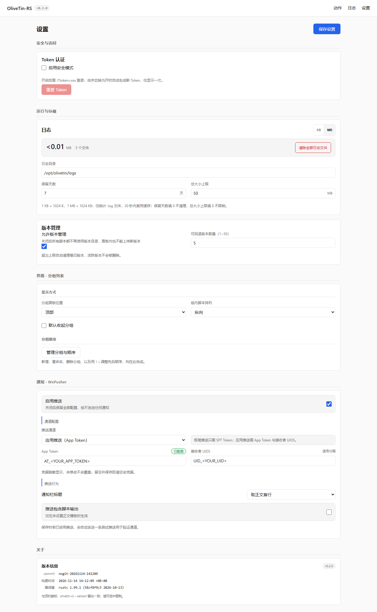

# OliveTin-RS 部署与使用说明

> 面向运维 / 部署人员的完整部署手册。覆盖架构、性能、编译、安全、推送与后台驻留。

---

## 1. 项目简介与免责声明

**OliveTin-RS** 是一个超轻量级的**脚本管理与定时任务面板**，用于把命令 / 脚本包装成 Web 按钮，并提供定时调度、参数采集、日志持久化与消息推送能力。

> ### ⚠️ 重要声明
> - **本项目绝非 OliveTin 的 Rust 重构版，也不是其官方分支。** 它是一个独立开发的项目，仅在设计理念上参考了类似的面板工具（将脚本包装为可点击的 Web 动作），代码、架构与实现均为独立完成，与 OliveTin 无任何代码或组织上的关联。
> - **本项目主要定位为局域网（内网）环境下的边缘设备管理**，自带轻量级的 Token 鉴权机制，但**不建议将其直接暴露在公网**。如需公网访问，请自行配置反向代理、防火墙限源与 HTTPS。

### 核心架构

- **单文件部署**：前端资源（CSS / JS）在编译期通过 `include_str!` 内联进二进制，产物是**单个可执行文件**，无需额外部署静态资源服务器。
- **基于 Rust**：底层为 tokio + axum 异步运行时，稳定、低开销、内存安全。
- **受限的文件执行模式**：脚本以**数组参数直接 `exec`** 执行（脚本 / 二进制），**而非裸 Shell 拼接**，从根本上规避命令注入与 Shell 元字符风险；不支持 `>`、`|`、`&&` 等重定向 / 管道（这类需求请写成脚本文件）。

---

## 2. 极致性能与资源占用

本项目**专为 OpenWrt / 路由器 / 边缘计算设备等资源受限环境打造**，在极低的硬件预算下依然流畅运行。以下指标为 **aarch64（MT7981）实测数据**：

- **超低内存占用**：常驻内存（VmRSS）仅约 **3.8 MB**，几乎不影响路由器上运行的其他服务。
- **极速冷启动**：从零启动到监听端口仅需 **3 毫秒**（`listening on 0.0.0.0:1337 in 3ms`）。
- **零外部依赖**：采用**静态链接（musl）**与**前端资源编译期内联**，单文件即完整服务，**无需部署 Nginx 或 Node.js**，也无任何动态链接库依赖。

> 以上数据来自生产环境实测：交叉编译产物约 4.8 MB，`readelf -l` 无 `PT_INTERP` 段（确认静态链接）。

---

## 3. 核心功能

### 3.1 脚本上传与命令生成

- 面板内直接**上传脚本二进制 + 配置**（带进度条），自动落盘并生成 `current` 软链接。
- 支持**版本管理**：上传新版本、切换、回退，`current` 软链接自动维护。
- 快速添加一行命令，自动包装为可执行脚本。

### 3.2 定时调度

- 四种调度模式：`daily` / `weekly` / `monthly` / `cron`，统一编译为 cron 表达式并自动排期。
- 支持时区（`+08:00`）、`skip_if_running` 防止重复触发。

### 3.3 参数发现

- 通过脚本的 `--help` / `-h` / `help` 输出**自动解析参数**，生成 Web 表单。
- 内置四种解析器：`clap` / `cobra` / `sections` / `lines`，带类型启发式推断（string / int / bool 等）。

> 更多功能（日志持久化、操作审计、WxPusher 推送、Token 认证、配置热加载）详见 [README.md](README.md)。

### 界面截图

> ⚠️ 以下为截图占位符，请在 `docs/images/` 下放置真实截图。




---

## 4. 编译与打包指南

### 环境要求

| 依赖 | 用途 | 说明 |
|---|---|---|
| Rust 工具链 | 编译 | 1.70+（本项目在 1.99.1 上验证） |
| Zig | musl 交叉编译 | 提供 aarch64 等目标的 musl 链接器（0.13.0 验证） |

### 本地编译

```bash
cargo build --release
```

产物：`target/release/olivetin-rs`

### 交叉编译（以 aarch64 musl 为例）

```bash
# 1. 添加目标
rustup target add aarch64-unknown-linux-musl

# 2. 配置链接器（见 tools/zig-cc.bat、tools/zig-ar.bat、tools/zig-cc.py 顶部注释）
#    Windows 宿主需在 .cargo/config.toml 中把 linker 设为项目内 tools/zig-cc.bat 的绝对路径

# 3. 编译
cargo build --release --target aarch64-unknown-linux-musl
```

产物位于 **`target/aarch64-unknown-linux-musl/release/olivetin-rs`**（musl 静态单文件，约 4.8 MB）。

> 验证静态链接：`readelf -l <产物> | grep -i interp`，无输出即表示静态链接成功。

---

## 5. 消息推送支持（WxPusher）

系统**原生支持任务执行结果的消息推送**，目前**仅支持 [WxPusher](https://wxpusher.zjiecode.com/)（微信推送服务）**，并完美支持其两种模式：

- **极简模式（SPT）**：直接通过 SPT 凭据推送，无需配置 AppToken 与 UIDS。
- **应用模式（AppToken）**：通过应用 AppToken + UIDS 推送到指定用户。

推送条件支持：`always`（总是）/ `on_success`（成功）/ `on_failure`（失败）/ `on_marker`（脚本输出 `[PUSH]` 标记）。

配置示例：

```yaml
push:
  enabled: true
  spt: "${WXPUSHER_SPT}"   # 极简模式；应用模式改用 app_token + uids
  content_type: 1
  include_output: false
  timeout: 10
```

> 凭据请通过环境变量注入（如上例 `${WXPUSHER_SPT}`），**切勿硬编码到配置文件中**。

---

## 6. 安全配置

### 安全加固建议

1. **绑定内网 IP**：默认监听 `127.0.0.1`，如需局域网访问，仅绑定内网网卡地址：

   ```bash
   OLIVETIN_BIND=192.168.1.100:1337 ./olivetin-rs --config config.yaml
   ```

2. **配合防火墙拒绝公网访问**：在路由器 / 主机防火墙上仅放行内网网段，拒绝来自 WAN 的 1337 端口访问。

3. **严格限制脚本保存目录白名单**：将 `script_directory` 限定在受控目录（如 `/opt/olivetin/scripts`），避免脚本被写入任意系统路径。

4. **启用 Token 鉴权**：在设置页开启「安全模式」，Token 通过 `token_file` 持久化；Token 文件权限应设为 `600`。

```yaml
auth:
  enabled: true
  token_file: "/etc/olivetin-rs/token.txt"
  cookie_ttl_hours: 168
```

设置页集中管理 Token 认证、日志保留策略、版本管理、WxPusher 推送通道等安全相关配置：



---

## 7. 运行与后台驻留

### 简单启动

```bash
./olivetin-rs --config config.yaml
# 或绑定内网地址
OLIVETIN_BIND=0.0.0.0:1337 ./olivetin-rs --config config.yaml
```

### systemd 托管（通用 Linux）

```ini
# /etc/systemd/system/olivetin-rs.service
[Unit]
Description=OliveTin-RS Script Panel
After=network.target

[Service]
Type=simple
ExecStart=/usr/local/bin/olivetin-rs --config /etc/olivetin-rs/config.yaml
Environment=OLIVETIN_BIND=0.0.0.0:1337
Restart=on-failure
RestartSec=5

[Install]
WantedBy=multi-user.target
```

```bash
systemctl daemon-reload
systemctl enable --now olivetin-rs
```

### OpenWrt procd 托管

```sh
# /etc/init.d/olivetin-rs
#!/bin/sh /etc/rc.common
START=99
USE_PROCD=1

start_service() {
    procd_open_instance
    procd_set_param command /usr/local/bin/olivetin-rs --config /etc/olivetin-rs/config.yaml
    procd_set_param env OLIVETIN_BIND=0.0.0.0:1337
    procd_set_param respawn
    procd_set_param stdout 1
    procd_set_param stderr 1
    procd_close_instance
}
```

```bash
chmod +x /etc/init.d/olivetin-rs
/etc/init.d/olivetin-rs enable
/etc/init.d/olivetin-rs start
```

---

## 故障排查

```bash
# 校验配置
olivetin-rs --check-config --config /etc/olivetin-rs/config.yaml

# 查看进程与监听
pidof olivetin-rs
netstat -tlnp | grep 1337

# 查看日志（日志目录见 config.yaml 的 log_directory）
tail -f /opt/olivetin/logs/panel-*.log
```
